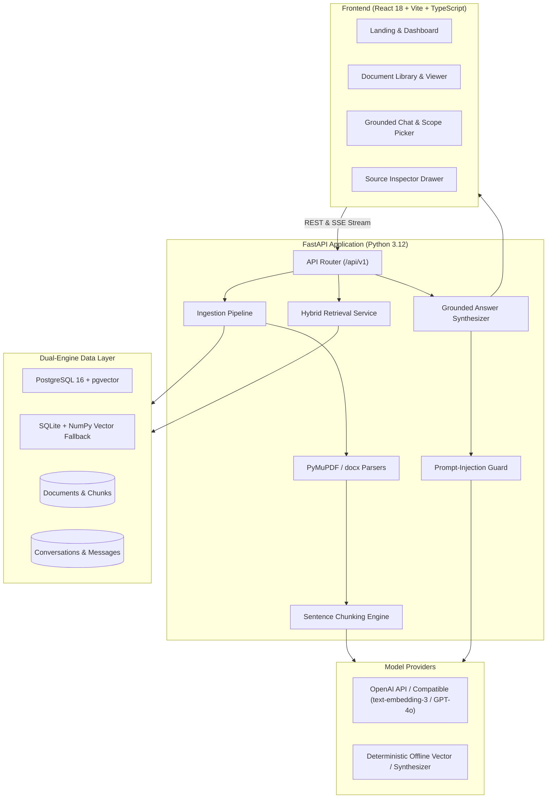

# RAGMind — AI Knowledge Engine

> **“Your documents. Your knowledge. Answers you can verify.”**

RAGMind is an enterprise-grade, production-oriented Retrieval-Augmented Generation (RAG) platform. It transforms disparate PDFs, Word documents, Markdown archives, and plain text files into an interactive, verifiable intelligence repository. Rather than passing questions ungrounded to a raw LLM, RAGMind implements a verifiable retrieval pipeline: page-aware parsing, semantic chunking, vector embedding, hybrid semantic + lexical search, prompt-injection defense, and interactive inline citation tracking.

---

## 🌟 Key Capabilities

- **Multi-Format Ingestion**: Page-aware extraction for PDF (`PyMuPDF` with OCR-readiness checks), DOCX (`python-docx`), Markdown (`.md`), and plain text (`.txt`).
- **Semantic & Deterministic Chunking**: Sentence-boundary respecting chunker with configurable token windows (default 500 tokens) and overlap (default 100 tokens), preserving page numbers and section headings.
- **Dual-Engine Vector Database**:
  - **PostgreSQL + pgvector** (`pgvector/pgvector:pg16`): Scalable HNSW/IVFFlat cosine similarity search for production deployments.
  - **Zero-Dependency SQLite Vector Engine**: Built-in persistent fallback with NumPy cosine math for offline testing, local developer environments, and CI sandboxes.
- **Hybrid Retrieval (Dense + Sparse)**: Fuses vector cosine similarity with lexical keyword overlap to ensure acronyms, identifiers, and exact phrases are retrieved reliably.
- **Strict Grounding & Abstention Guard**: Explicitly abstains from hallucinating answers when evidence is insufficient or when queries fall outside the document corpus.
- **Traceable Interactive Citations**: Every claim is mapped to bracket citations (`[1]`, `[2]`), allowing users to click citations to view exact supporting passages, match percentages, and page locations in the **Source Inspector**.
- **Real-Time Streaming**: High-throughput Server-Sent Events (SSE) streaming endpoint (`/api/chat/stream`) and synchronous fallback (`/api/chat`).
- **Full Scope Control**: Query across all documents, target a curated **Thematic Collection**, or restrict queries to individual documents.
- **Calm, High-Information UI/UX**: Designed with a warm neutral theme, deep charcoal typography, responsive desktop/tablet/mobile layouts, and seamless dark mode switching.

---

## 🏗️ Architecture



---

## 🛠️ Technology Stack

| Tier | Technologies |
| :--- | :--- |
| **Frontend** | React 18, TypeScript, Vite, Tailwind CSS, TanStack Query v5, React Router v6, Lucide Icons, React Markdown |
| **Backend** | Python 3.12+, FastAPI, SQLAlchemy 2.0, Pydantic v2, Alembic, PyMuPDF, python-docx, httpx, NumPy |
| **Database** | PostgreSQL 16 + `pgvector` (production), SQLite 3 (offline/sandbox fallback) |
| **AI Layer** | OpenAI-compatible embedding API (`text-embedding-3-small`), Generation (`gpt-4o-mini`), and local deterministic fallback |
| **DevOps & Testing** | Docker, Docker Compose, Nginx, Pytest, Vitest, React Testing Library |

---

## 🚀 Quickstart Guide

### Option A: Run with Docker Compose (Recommended)

1. Clone or navigate to the repository directory:
   ```bash
   cd charming-newton
   ```

2. Copy the sample environment file:
   ```bash
   cp .env.example .env
   ```
   *(Optionally, configure your `OPENAI_API_KEY` in `.env` if you want live external LLM generation; otherwise, RAGMind operates autonomously in local mode).*

3. Build and launch all services:
   ```bash
   docker compose up --build -d
   ```

4. Access the applications:
   - **Frontend Workspace**: `http://localhost:3000`
   - **Backend API & Swagger Docs**: `http://localhost:8000/docs`
   - **PostgreSQL pgvector**: `localhost:5432` (`ragmind` / `ragmind_pass`)

---

### Option B: Local Development Setup

#### 1. Backend Setup

```bash
cd backend

# Create virtual environment
python -m venv .venv
# Windows PowerShell:
.\.venv\Scripts\Activate.ps1
# macOS/Linux:
# source .venv/bin/activate

# Install dependencies
pip install -r requirements.txt

# Run database migrations (if using PostgreSQL)
alembic upgrade head

# Start FastAPI server
python -m uvicorn app.main:app --host 0.0.0.0 --port 8000 --reload
```

The backend automatically detects whether PostgreSQL is available. If PostgreSQL is not reachable, it automatically initializes the persistent SQLite vector store at `backend/data/ragmind.db`.

#### 2. Frontend Setup

```bash
cd frontend

# Install packages
npm install

# Start Vite dev server with proxy to localhost:8000
npm run dev
```

Navigate to `http://localhost:3000`.

---

## 🧪 Verification & Testing

RAGMind includes comprehensive test suites across both backend and frontend layers.

### Run Backend Tests (Pytest)
```bash
cd backend
.\.venv\Scripts\pytest -v app/tests
```
**Outcome**:
- `test_parsers.py`: PDF, DOCX, TXT, MD parsing and unsupported format rejection.
- `test_chunking.py`: Sentence preservation, token limits, and deterministic chunk indexing.
- `test_embeddings.py`: Vector dimensions and batch generation.
- `test_retrieval_and_generation.py`: Grounded citation mapping, abstention on out-of-domain queries, and prompt injection defense.
- `test_api_endpoints.py`: End-to-end ingestion, collection assignment, and chat.
- `test_health.py`: Liveness, readiness, and database checks.
- **Result: 16 Passed, 0 Failed.**

### Run Frontend Tests (Vitest)
```bash
cd frontend
npm test
```
**Outcome**:
- `landing.test.tsx`: Landing page branding, product promise, and workspace navigation.
- `components.test.tsx`: Design system components (`Badge`, `StatusBadge`, `Button`, `Card`, `EmptyState`, `SourceInspector`).
- `chat_scope.test.tsx`: Interactive inline citation rendering (`[1]`, `[2]`) and click-to-inspect handlers.
- **Result: 3 Test Files Passed, 9 Passed.**

### Run End-to-End System Smoke Test
```bash
cd backend
.\.venv\Scripts\python.exe smoke_test.py
```
**Outcome**:
- Validates database connection and health status.
- Uploads and indexes a multi-sentence document into the vector store.
- Verifies chunk indexing and token statistics.
- Executes grounded RAG question and asserts citation tracking (`[1]`).
- Tests out-of-domain query and asserts strict abstention.
- **Result: All 5 Stages Passed.**

### Run Production Frontend Build
```bash
cd frontend
npm run build
```
**Outcome: TypeScript strict compilation (`tsc`) and Vite bundling complete with 0 errors.**

---

## 📖 API Reference

### Health & Settings
- `GET /api/health` — System status, active database type (`postgresql` or `sqlite`), and AI provider readiness.
- `GET /api/health/ready` — Kubernetes/Docker readiness probe.
- `GET /api/settings` — Current retrieval top-k, relevance thresholds, chunk size, and model configurations.
- `PUT /api/settings` — Update runtime hyperparameters (chunk size, overlap, temperature, hybrid toggle).

### Document Ingestion & Management
- `POST /api/documents/upload` — Upload multipart file (`PDF`, `DOCX`, `TXT`, `MD`) with optional collection ID.
- `GET /api/documents` — List documents with optional filtering by status (`READY`, `PROCESSING`, `FAILED`), collection, or keyword search.
- `GET /api/documents/{id}` — Retrieve document details, processing status, and metadata.
- `GET /api/documents/{id}/chunks` — Retrieve parsed chunks with page numbers, token counts, and text previews.
- `DELETE /api/documents/{id}` — Delete document and cascade delete its chunks and vector embeddings.
- `GET /api/documents/stats` — Real-time metrics on total documents, indexed chunks, and ingestion statuses.

### Thematic Collections
- `GET /api/collections` — List all collections with document counts.
- `POST /api/collections` — Create a new collection.
- `DELETE /api/collections/{id}` — Delete collection (preserves documents by unlinking them).

### Conversational RAG
- `POST /api/chat` — Send a query against an active document scope (`ALL`, `COLLECTION`, `DOCUMENTS`) and receive a grounded answer with citations and retrieval latency diagnostics.
- `POST /api/chat/stream` — Real-time Server-Sent Events (SSE) streaming answer delivery.
- `GET /api/conversations` — List conversation history.
- `GET /api/conversations/{id}` — Fetch conversation thread and message citations.
- `DELETE /api/conversations/{id}` — Remove conversation history.

---

## 🛡️ Security & Reliability Guardrails

1. **Prompt Injection Defense**: User queries and retrieved passages are segregated in strict system/context delimiters. Any instructional injection attempt within document content (e.g. "Ignore previous instructions") is neutralized by the system guardrail.
2. **File Validation & Deduplication**: Uploads are validated against strict MIME types, maximum size limits (`MAX_UPLOAD_SIZE_MB`), and evaluated for SHA-256 duplicate content to prevent redundant storage and embedding costs.
3. **No Key Exposure**: External LLM API keys are kept strictly in backend environment variables and are never transmitted to the browser client.
4. **Transparent Diagnostics**: Every response includes retrieval latency, chunk count, search scope, and top relevance score for auditing.

---

## 📄 License
This project is open-source under the MIT License.
